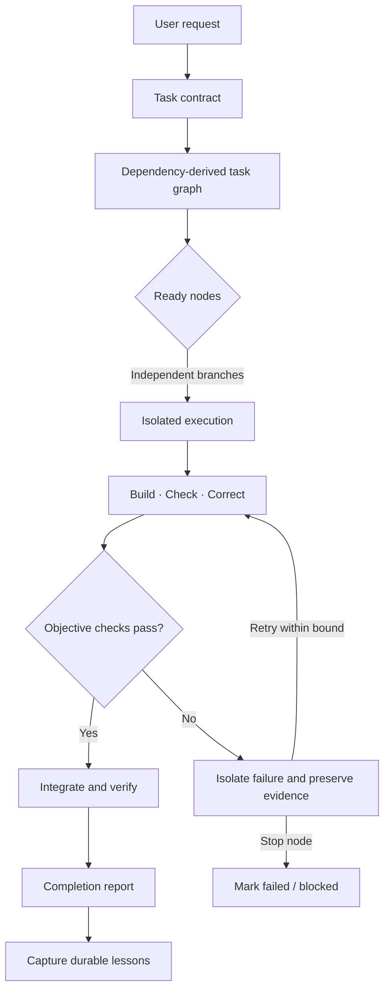

<div align="center">

# GraphLatch

### Contract-driven orchestration for reliable agentic engineering

**Plan with intent. Execute with isolation. Finish with evidence.**

[](LICENSE)
[](https://agentskills.io/)
[](https://www.python.org/)

A lightweight, agent-agnostic operating protocol that turns substantial engineering work into an explicit contract, a dependency-derived task graph, isolated execution, deterministic checks, and an evidence-backed completion report.

[Get started](#quick-start) · [How it works](#the-graphlatch-method) · [Install](#install-the-skill) · [Contribute](#contributing)

</div>

---

## Why GraphLatch?

A capable coding agent can write code quickly. Reliability is harder: keeping work inside scope, coordinating parallel agents without file collisions, knowing when a task is truly complete, and recovering from failures without endless retries.

GraphLatch provides a repeatable control loop for that work. Before implementation, it makes the goal and acceptance criteria explicit. It then models the work as a directed acyclic graph (DAG), runs only genuinely independent tasks in parallel, validates each result with objective checks, and records failures without allowing one broken branch to derail the rest.

**GraphLatch is a methodology and portable agent skill—not an autonomous runtime, scheduler, sandbox, or guarantee of correctness.** Your coding agent and development environment still perform the work. GraphLatch gives them a disciplined operating protocol and optional tooling to validate the task graph itself.

## The method at a glance



## Core principles

| Principle | What it means in practice |
|---|---|
| **Contract before code** | Define the goal, constraints, completion predicates, and out-of-scope work before changing files. |
| **Dependencies before parallelism** | Add an edge only when one task needs an output or decision from another. Parallelize only independent nodes. |
| **Isolation before concurrency** | Give parallel workers non-overlapping write scopes and separate worktrees or equivalent isolated workspaces. |
| **Checks before claims** | Completion requires observable acceptance checks—not an agent saying “done.” |
| **Bounded retries** | Allow at most three build/check/correct cycles per node; stop earlier when the same failure repeats without new evidence. |
| **Localize failure** | A failed node blocks its dependants, not unrelated branches. Preserve diagnostics and partial work. |
| **Risk-aware autonomy** | Read-only and reversible work can proceed within scope; ambiguous, destructive, or externally impactful actions require approval. |
| **Learn deliberately** | Keep run-specific facts in `STATE.md`; promote only repeated, generalizable lessons into durable project instructions. |

## Quick start

### 1. Install the skill

Clone GraphLatch, then copy the `skill/graph-latch` directory into the location used by your coding agent. For a project-local installation, use one of these paths:

| Agent | Project skill location |
|---|---|
| Claude Code | `.claude/skills/graph-latch/` |
| Codex | `.agents/skills/graph-latch/` |
| OpenCode | `.opencode/skills/graph-latch/` |

Example for Claude Code:

```bash
git clone https://github.com/bidhata/GraphLatch.git
mkdir -p .claude/skills
cp -R GraphLatch/skill/graph-latch .claude/skills/
```

See [Installation and agent adapters](docs/installation.md) for the exact steps and invocation notes for each agent.

### 2. Start a substantial task

Ask your agent to use GraphLatch for a multi-step engineering task, or invoke the skill directly where supported:

```text
Use GraphLatch to implement the requested change.
First establish the task contract, then build the dependency graph.
Do not begin implementation until the completion criteria and scope are clear.
```

### 3. Create a task contract and graph

Copy the templates into the project or ask the agent to create task-local versions:

```text
cp skill/graph-latch/templates/TASK_CONTRACT.md ./TASK_CONTRACT.md
cp skill/graph-latch/templates/task-graph.json ./task-graph.json
cp skill/graph-latch/templates/STATE.md ./STATE.md
```

The graph is deliberately stored as JSON so it can be validated using Python's standard library without installing extra packages.

### 4. Validate the graph

```bash
python3 scripts/validate_graph.py examples/graph.json
```

Validate GraphLatch's own package and tests:

```bash
./check.sh
```

The graph validator checks structure, required fields, dependency references, duplicate IDs, and cycles. It does **not** execute tasks, create worktrees, run project tests, or prove that a graph is well designed. The agent remains responsible for those decisions and actions.

## The GraphLatch method

### 1. Establish a task contract

Every substantial run begins with four things:

- **Goal:** the observable outcome requested.
- **Constraints:** scope, compatibility, security, performance, style, and operational limits.
- **Done when:** objective, testable completion predicates.
- **Out of scope:** changes and actions that must not be performed.

If a material ambiguity affects safety, authorization, scope, or correctness, ask one focused question before acting. Do not turn assumptions into facts.

### 2. Derive the task graph

Break the goal into small, independently verifiable nodes. Each node records its goal, inputs, outputs, dependencies, permitted write scope, acceptance checks, risk, and status.

A dependency edge `A → B` is justified only when B requires an artifact, decision, or state produced by A. Tasks without dependency edges may run in the same execution wave—provided their write scopes do not conflict.

### 3. Execute with isolation

Parallelize only work that is genuinely independent. Prefer a separate Git worktree or equivalent isolated workspace for each parallel implementation node. Give each worker a narrow task contract, explicit permitted files, interface assumptions, required checks, and a prohibition on unrelated changes.

If two tasks must edit the same files, serialize them or redesign the split. Do not let workers concurrently modify the same working tree and hope that integration will sort it out.

### 4. Build, check, and correct

For each node:

1. Inspect relevant code, project instructions, and conventions.
2. Implement the smallest change that satisfies the node.
3. Run the narrowest relevant deterministic check.
4. Inspect the output and the complete diff for the node's write scope.
5. Correct based on diagnostic evidence, then rerun the check.

Use no more than **three total implementation/check cycles per node**. Stop sooner if the same failure reproduces twice without meaningful new evidence. Do not rerun an identical failed command merely to hope for a different result.

If the target repository has a `./check.sh`, use it at the appropriate integration stage. If it does not, identify the relevant project commands and acceptance checks; never pretend a missing script exists or silently claim a check passed.

### 5. Isolate failures

When a node fails, mark that node failed and mark only its dependent nodes blocked. Continue with unrelated ready nodes when safe. Preserve the exact failing command, relevant output, attempts, changes between attempts, current hypothesis, and evidence needed to proceed.

A hypothesis is not a finding. A command not run is not a passing check. Partial completion must remain visible.

### 6. Gate by risk

| Gate | Use when | Behaviour |
|---|---|---|
| **ALLOW** | Read-only inspection or low-risk, reversible changes within the contract | Proceed and record material decisions. |
| **ASK** | Scope is ambiguous; an action is destructive, hard to reverse, externally impactful, or needs credentials/authorization | Pause and obtain explicit approval. |
| **DENY** | The action is out of scope, unauthorized, or would create unacceptable harm | Do not perform it; explain the boundary. |

For security testing, require explicit authorization and a defined target scope before active testing. Respect the approved assets, methods, time window, rate limits, and stop conditions. Technical reachability is not authorization.

### 7. Integrate, verify, and learn

Integrate completed nodes in dependency order. Review the aggregate diff, check cross-node interfaces, run the broadest relevant validation, and re-evaluate every completion predicate from the original contract.

Keep run-specific progress and evidence in `STATE.md`. Keep durable conventions in `AGENTS.md`, `CLAUDE.md`, or the appropriate project instruction file. Promote a lesson only after the same failure pattern has occurred at least twice and the rule is generalizable. Never store secrets or credentials in project memory files.

Finish with an outcome, completed/failed/blocked nodes, exact validation commands and results, key changes, remaining risks, and any unverified acceptance criteria.

## Repository layout

```text
GraphLatch/
├── README.md
├── LICENSE
├── check.sh
├── docs/
│   ├── architecture.md
│   └── installation.md
├── examples/
│   ├── graph.json
│   └── STATE.md
├── scripts/
│   └── validate_graph.py
├── skill/
│   └── graph-latch/
│       ├── SKILL.md
│       ├── references/
│       │   └── protocol.md
│       └── templates/
│           ├── STATE.md
│           ├── TASK_CONTRACT.md
│           └── task-graph.json
└── tests/
    └── test_validate_graph.py
```

## What GraphLatch is—and is not

**It is:** a portable operating protocol, an Agent Skills-compatible instruction bundle, a task-graph data format, and a small standard-library validator.

**It is not (yet):** a multi-agent runtime, process scheduler, worktree manager, CI service, security scanner, or formal proof system. Those capabilities require explicit tooling and agent/environment integrations. The protocol is designed to make such integrations possible without making them prerequisites for using the method.

## Compatibility

The core workflow is agent-independent. The included skill uses the open Agent Skills structure (`SKILL.md` with YAML frontmatter) and can be installed in supported skill directories. Claude Code, Codex, and OpenCode each document project-level skill locations; see [installation notes](docs/installation.md).

Agent features differ. For example, availability of subagents, parallel execution, worktree support, approval controls, and skill invocation depends on the agent and its configuration. GraphLatch does not assume every environment supports all of them; the skill instructs the agent to use equivalent isolation or serialize work when needed.

## Contributing

Issues, examples, adapter improvements, and protocol critiques are welcome. Please keep proposals grounded in observable engineering failure modes and avoid adding process for its own sake.

Before proposing a new mandatory rule, include:

1. The failure mode it addresses.
2. The evidence that the failure is repeatable.
3. The smallest actionable rule that prevents or limits it.
4. Any trade-offs or added coordination cost.

Run the package checks before submitting a change:

```bash
./check.sh
```

## Created by

GraphLatch is created and maintained by **Krish Paul** ([@bidhata](https://github.com/bidhata)).

- **Website:** [krishnendu.com](https://krishnendu.com)
- **Email:** [me@krishnendu.com](mailto:me@krishnendu.com)
- **GitHub:** [@bidhata](https://github.com/bidhata)

For project questions, ideas, or collaboration, please open a [GitHub issue](https://github.com/bidhata/GraphLatch/issues) or get in touch by email.

## License

GraphLatch is released under the [MIT License](LICENSE).

---

<div align="center">

**GraphLatch** · Orchestrate deliberately. Verify independently.

[GitHub repository](https://github.com/bidhata/GraphLatch) · [Website](https://krishnendu.com) · [Email](mailto:me@krishnendu.com)

</div>
